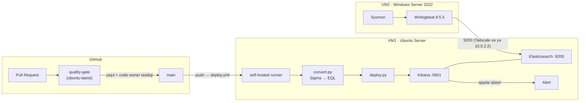

# Sıfırdan quraşdırma təlimatı

Bu sənəd boş kompüterdən işləyən Detection-as-Code sisteminə qədər bütün addımları təsvir edir. Hər əmr olduğu kimi kopyalanıb işlədilə bilər. `<...>` içindəki yerlər öz dəyərinizlə əvəz olunur.

## Arxitektura



İki yol var:

- **Qayda yolu:** Sigma PR → quality-gate (sintaksis, metadata, çevrilmə, testlər) → review → main → VM1-dəki runner → `convert.py` → `deploy.py` → Kibana.
- **Hadisə yolu:** VM2-də əmr → Sysmon → Winlogbeat → ingest pipeline (ECS sahələri) → Elasticsearch → Kibana qaydası → alert.

| Komponent | Harada | Versiya |
|---|---|---|
| Elasticsearch, Kibana | VM1, Docker Compose | 9.5.5 |
| GitHub Actions runner | VM1, systemd xidməti | GitHub-ın verdiyi son versiya |
| Sysmon | VM2 | v15.x + SwiftOnSecurity konfiqurasiyası |
| Winlogbeat | VM2, Windows xidməti | 9.5.5 (Elastic ilə eyni) |
| pySigma, sigma-cli | runner və CI | `requirements.txt` |

## Ön şərtlər

- 16 GB RAM-lı kompüter (VM1 6 GB + VM2 4 GB)
- VirtualBox 7.x: [virtualbox.org/wiki/Downloads](https://www.virtualbox.org/wiki/Downloads) → **Windows hosts** → quraşdırıcını standart seçimlərlə işə salın (şəbəkə adapterləri quraşdırılarkən internet bir neçə saniyə kəsilə bilər)
- Ubuntu Server ISO ([ubuntu.com/download/server](https://ubuntu.com/download/server)) və Windows Server 2022 Evaluation ISO (Microsoft Evaluation Center). ISO faylı **açılmır** (WinRAR ilə extract etməyin), VirtualBox-a `.iso` faylının özü verilir
- GitHub hesabı və repoya admin icazəsi

---

## Hissə A: VM1 (SIEM)

### A1. VM-i yarat

VirtualBox → **New**:

| Parametr | Dəyər |
|---|---|
| Ad | `vm1-siem` |
| ISO | Ubuntu Server (`.iso` faylının özü, açılmamış) |
| Unattended Installation | **söndürülmüş** ("Skip Unattended Installation") |
| RAM / CPU / Disk | 6144 MB / 4 / 50 GB |

VM-i işə salın, Ubuntu quraşdırıcısında:

1. Dil: English → klaviatura: standart
2. Quraşdırma növü: **Ubuntu Server** (minimized yox)
3. Şəbəkə: dəyişmədən (DHCP), proxy və mirror: boş/standart
4. Disk: **Use an entire disk** → Done → Continue
5. Profil: ad, server adı `vm1-siem`, istifadəçi adı və parol
6. ✅ **Install OpenSSH server**
7. Snaps: heç birini seçməyin → quraşdırma bitəndə **Reboot Now**

İstifadəçi adı bu sənəddə `huseyn` kimi göstərilib.

### A2. Port yönləndirmə

VM sönülü ikən: **Settings → Network → Adapter 1 (NAT) → Advanced → Port Forwarding**:

| Ad | Host Port | Guest Port |
|---|---|---|
| ssh | 2222 | 22 |
| kibana | 5601 | 5601 |
| elastic | 9200 | 9200 |

Host kompüterdən qoşulma:

```bash
ssh -p 2222 huseyn@localhost
```

### A3. Saat

Qaydalar hər 5 dəqiqədə son 6 dəqiqəyə baxır, ona görə saat səhvdirsə, alert gəlmir.

```bash
sudo timedatectl set-timezone Asia/Baku
sudo systemctl restart chrony
sudo chronyc makestep
timedatectl
```

`System clock synchronized: yes` olmalıdır. VM-i **"Save the machine state" ilə dayandırmayın**, `sudo poweroff` ilə söndürün. Save state saatı dondurur (bizdə 13 saat fərq yaranmışdı).

### A4. Docker

```bash
curl -fsSL https://get.docker.com | sudo sh
sudo usermod -aG docker $USER
```

SSH-dən çıxıb yenidən qoşulun, sonra yoxlayın:

```bash
docker run --rm hello-world
```

### A5. Elasticsearch və Kibana

```bash
sudo sysctl -w vm.max_map_count=262144
echo 'vm.max_map_count=262144' | sudo tee /etc/sysctl.d/99-elastic.conf

git clone https://github.com/H11s3yn/detection-as-code.git
mkdir -p ~/siem && cp detection-as-code/siem/docker-compose.yml ~/siem/
cd ~/siem

cat > .env <<EOF
STACK_VERSION=9.5.5
ELASTIC_PASSWORD=$(openssl rand -hex 12)
KIBANA_PASSWORD=$(openssl rand -hex 12)
ENCRYPTION_KEY=$(openssl rand -hex 32)
EOF
chmod 600 .env

docker compose up -d
docker compose ps -a
```

Gözlənilən nəticə: `elasticsearch` → `Up (healthy)`, `setup` → `Exited (0)`, `kibana` → `Up`. Kibana-nın tam qalxması 1–2 dəqiqə çəkir; o vaxta qədər "Kibana server is not ready yet" görünməsi normaldır.

Parol: `grep ELASTIC_PASSWORD ~/siem/.env`. Host kompüterdə `http://localhost:5601` → istifadəçi `elastic`.

**`.env` heç vaxt repoya əlavə olunmur və ekran şəklinə düşmür.** Ehtiyat nüsxəsini parol menecerində saxlayın.

Xidmətlər `restart: unless-stopped` ilə qurulub: VM yenidən açılanda özləri qalxır. Elastic-in hazır qaydaları (Prebuilt rules) **quraşdırılmır**, Kibana-da yalnız repodan gələn qaydalar olur.

### A6. Python (runner üçün)

```bash
sudo apt update && sudo apt install -y python3-venv python3-pip
```

---

## Hissə B: GitHub

### B1. Ruleset (main-in qorunması)

**Settings → Rules → Rulesets → New branch ruleset**, ad `main-protection`, target `main`, Enforcement **Active**, **Bypass list boş**:

- ✅ Restrict deletions
- ✅ Require a pull request before merging → Required approvals: **1** → ✅ Require review from Code Owners
- ✅ Require status checks to pass → ✅ Require branches to be up to date → check: **`quality-gate`** (GitHub Actions)
- ✅ Block force pushes

`quality-gate` siyahıda yalnız `pr-check.yml` ən azı bir dəfə işləyəndən sonra görünür.

Qəsdən açılmayan ayar: "Dismiss stale pull request approvals". Gate hər push-dan sonra yenidən işlədiyi üçün risk azdır, açılsa hər "Update branch"-dan sonra yenidən təsdiq lazım olur.

### B2. Secrets

**Settings → Secrets and variables → Actions → New repository secret**:

| Ad | Dəyər |
|---|---|
| `KIBANA_URL` | `http://localhost:5601` (runner VM1-in içindədir) |
| `KIBANA_USER` | `elastic` |
| `KIBANA_PASS` | `.env`-dəki `ELASTIC_PASSWORD` |

### B3. Self-hosted runner (VM1)

**Settings → Actions → Runners → New self-hosted runner → Linux, x64**. Səhifədəki "Download" və "Configure" əmrlərini VM1-də, ev qovluğunda işlədin (token səhifədən gəlir, heç yerdə paylaşılmır):

```bash
mkdir ~/actions-runner && cd ~/actions-runner
# səhifədəki curl ... və tar xzf ... əmrləri
./config.sh --url https://github.com/H11s3yn/detection-as-code --token <TOKEN> --name vm1-siem
```

Xidmət kimi quraşdırın ki, VM açılanda özü başlasın:

```bash
sudo ./svc.sh install
sudo ./svc.sh start
sudo systemctl status actions.runner.* --no-pager
```

GitHub-da runner **Idle** görünməlidir.

**Təhlükəsizlik:** self-hosted runner yalnız `deploy.yml`-də işləyir (main-ə push və əl ilə işə salma). `pr-check.yml` `runs-on: ubuntu-latest` istifadə edir: PR-dakı yoxlanmamış kod VM1-də heç vaxt icra olunmur. Public repoda bu qayda pozulmamalıdır.

### B4. Deploy-un yoxlanması

**Actions → Deploy → Run workflow → main**. "Kibana-ya yükləmə" addımında:

```
Kibana hazırdır
yükləndi: N qayda
```

VM yenicə açılıbsa, `deploy.py` əvvəlcə Kibana-nı gözləyir ("Kibana hələ hazır deyil ... gözləyirəm", maksimum 5 dəqiqə). Bu normaldır.

Kibana → **Security → Rules → Detection rules**: qaydalar `detection-as-code` teqi ilə görünür.

---

## Hissə C: VM2 (Windows, log mənbəyi)

### C1. VM-i yarat

| Parametr | Dəyər |
|---|---|
| ISO | Windows Server 2022 Evaluation |
| Edition | Standard (Desktop Experience) |
| RAM / CPU / Disk | 4096 MB / 2 / 50 GB |
| Unattended Installation | söndürülmüş |

Windows quraşdırıcısında:

1. Dil və klaviatura → **Next** → **Install now**
2. Əməliyyat sistemi: **Windows Server 2022 Standard Evaluation (Desktop Experience)**. Desktop Experience olmayan variant yalnız komanda sətri verir
3. Lisenziyanı qəbul edin → **Custom: Install Microsoft Server Operating System only**
4. Diski seçin → **Next**, quraşdırma bitənə qədər gözləyin
5. **Administrator** parolunu təyin edin → Ctrl+Alt+Del üçün VirtualBox menyusunda **Input → Keyboard → Insert Ctrl-Alt-Del**

Quraşdırmadan sonra saatı yoxlayın: **Settings → Time & language → Sync now**. Tarix səhvdirsə (bizdə 2021 göstərirdi), loglar Kibana-da "keçmişdə" qalır.

Sonrakı bütün addımlardan əvvəl **snapshot** götürün.

### C2. Şəbəkə: VM2 → VM1

| Ssenari | VM1 ünvanı | Necə |
|---|---|---|
| VM1 və VM2 eyni kompüterdə (final demo) | `10.0.2.2` | VM2 NAT adapterindədir, `10.0.2.2` host kompüterdir, A2-dəki port yönləndirmə 9200 və 5601-i VM1-ə ötürür |
| VM-lər fərqli kompüterlərdə | VM1-in Tailscale IP-si | Aşağıdakı Tailscale addımları |

**Tailscale (yalnız VM-lər fərqli kompüterlərdədirsə)**

VM1-də:

```bash
curl -fsSL https://tailscale.com/install.sh | sh
sudo tailscale up
```

`sudo tailscale up` bir link çıxarır: onu brauzerdə açıb Tailscale hesabına daxil olun. Sonra VM1-in ünvanını götürün:

```bash
tailscale ip -4
```

`100.x.y.z` formasında ünvan çıxacaq: bu, `<VM1_IP>`-dir.

VM2 başqa şəxsin kompüterindədirsə, onu şəbəkəyə dəvət edin: [login.tailscale.com/admin](https://login.tailscale.com/admin) → **Users → Invite users** → onun emaili.

VM2-də: [tailscale.com/download/windows](https://tailscale.com/download/windows) → quraşdırıcı → tray-dəki Tailscale ikonu → **Log in** → dəvət olunan hesabla daxil olun. Admin panelində **Machines** bölməsində hər iki maşın **Connected** görünməlidir.

Yoxlama (VM2-də PowerShell):

```powershell
Test-NetConnection <VM1_IP> -Port 9200
```

`TcpTestSucceeded : True` olmalıdır.

### C3. Sysmon

[Sysmon](https://learn.microsoft.com/sysinternals/downloads/sysmon) arxivini və [SwiftOnSecurity konfiqurasiyasını](https://github.com/SwiftOnSecurity/sysmon-config) (`sysmonconfig-export.xml`) eyni qovluğa yükləyin. Administrator PowerShell-də:

```powershell
.\Sysmon64.exe -accepteula -i sysmonconfig-export.xml
```

Yoxlama: **Event Viewer → Applications and Services Logs → Microsoft → Windows → Sysmon → Operational**, Event ID 1 (Process Create) yazılmalıdır.

### C4. Winlogbeat 9.5.5

Elastic saytından Winlogbeat **9.5.5** (Windows zip) yükləyin, `C:\Program Files\Winlogbeat`-ə açın. Versiya Elasticsearch ilə **eyni** olmalıdır.

`winlogbeat.yml`-in əsas hissələri:

```yaml
winlogbeat.event_logs:
  - name: Microsoft-Windows-Sysmon/Operational
  - name: Security
  - name: System
  - name: Microsoft-Windows-PowerShell/Operational

output.elasticsearch:
  hosts: ["http://<VM1_IP>:9200"]
  username: "elastic"
  password: "<ELASTIC_PASSWORD>"
  # Bu sətir olmadan loglar ECS sahələrinə çevrilmir (process.name və s. olmur),
  # qaydalar heç nə tapmır:
  pipeline: "winlogbeat-%{[agent.version]}-routing"

setup.kibana:
  host: "http://<VM1_IP>:5601"
```

Administrator PowerShell-də:

```powershell
cd "C:\Program Files\Winlogbeat"
Set-ExecutionPolicy -Scope Process Bypass
.\install-service-winlogbeat.ps1
.\winlogbeat.exe test config -c .\winlogbeat.yml
.\winlogbeat.exe test output -c .\winlogbeat.yml
.\winlogbeat.exe setup -e
Start-Service winlogbeat
```

`setup -e` index template-i və ingest pipeline-ları Elasticsearch-ə yükləyir.

**Data view** (Discover-də logları görmək üçün, bir dəfə): Kibana → **☰ → Stack Management → Data Views → Create data view**:

| Sahə | Dəyər |
|---|---|
| Name | `winlogbeat` |
| Index pattern | `winlogbeat-*` |
| Timestamp field | `@timestamp` |

→ **Save data view to Kibana**.

Yoxlama: Kibana → **Discover** → data view `winlogbeat` → `event.code : 1` sorğusunda `process.name`, `process.executable`, `process.command_line` sahələri görünməlidir. Yalnız `winlog.event_data.*` görünürsə, `pipeline:` sətri işləmir.

---

## Hissə D: Uçdan-uca yoxlama

1. VM2-də: `whoami`
2. 5–6 dəqiqə gözləyin.
3. Kibana → **Security → Alerts**: "whoami əmrinin icrası", host VM2-nin adı, severity low.

Hərf böyüklüyü yoxlaması: `wmic process call create "notepad.exe"` və `wmic Process Call Create "notepad.exe"`. EQL çevirməsi sayəsində **ikisi də** alert verməlidir.

Atomic Red Team kimi hücum simulyasiyaları yalnız VM2-də və yalnız snapshot-dan sonra işlədilir.

---

## Problemlər və həlli

| Əlamət | Səbəb | Həll |
|---|---|---|
| Kibana-da "Last run 9 hours ago", alert yoxdur | VM1-in saatı geri qalıb (save state) | `sudo systemctl restart chrony && sudo chronyc makestep` |
| VM2 hadisələri Discover-də görünmür | VM2-nin tarixi səhvdir | Windows vaxt sinxronizasiyası |
| Yalnız `winlog.event_data.*` sahələri var | Winlogbeat ingest pipeline-ı istifadə etmir | `winlogbeat.yml`-ə `pipeline:` sətri, xidməti yenidən başladın |
| Qayda heç vaxt alert vermir, hadisə isə var | `ecs_windows` `.caseless` sahəsinə istinad edir, Winlogbeat-də bu sahə yoxdur | `convert.py`-dəki `WINLOGBEAT_FIX` |
| Deploy `RemoteDisconnected` ilə düşür | VM açılanda runner Kibana-dan tez oyanır | `deploy.py`-dəki `wait_for_kibana()` (PR #31) |
| Deploy saatlarla "Queued" qalır | VM1 sönülüdür və ya runner işləmir | VM1-i açın, `sudo systemctl restart actions.runner.*` |
| `wmic Process Call Create` alert vermir | Lucene `keyword` sahəsində hərf böyüklüyünə həssasdır | `convert.py` EQL-ə keçirildi (`like~`, `:`) |
| EQL sorğusu `400 Bad Request` | Qaydada `\|re` regex-i `/` simvolu ilə | Regex əvəzinə `contains`/`endswith` |
| "Kibana server is not ready yet" | Kibana hələ qalxır | 1–2 dəqiqə gözləyin; davam edirsə `docker compose ps` və `docker compose logs kibana --tail 20` |

## Bilinən məhdudiyyətlər

- Winlogbeat `elastic` superuser hesabı ilə yazır. İstehsalat mühitində yalnız yazma icazəsi olan ayrıca istifadəçi və ya API açarı istifadə olunmalıdır.
- HTTP (TLS-siz) yalnız qapalı laboratoriya şəbəkəsi üçündür.
- VM1 sönülü olanda baş verən hadisələr üçün alert yaranmır: qaydalar yalnız son 6 dəqiqəyə baxır.
